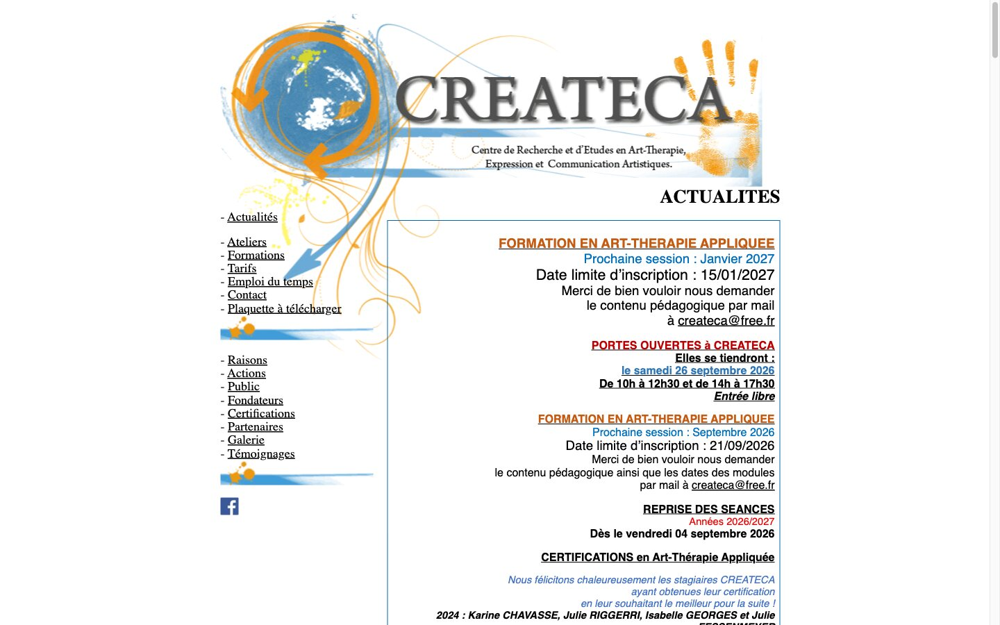
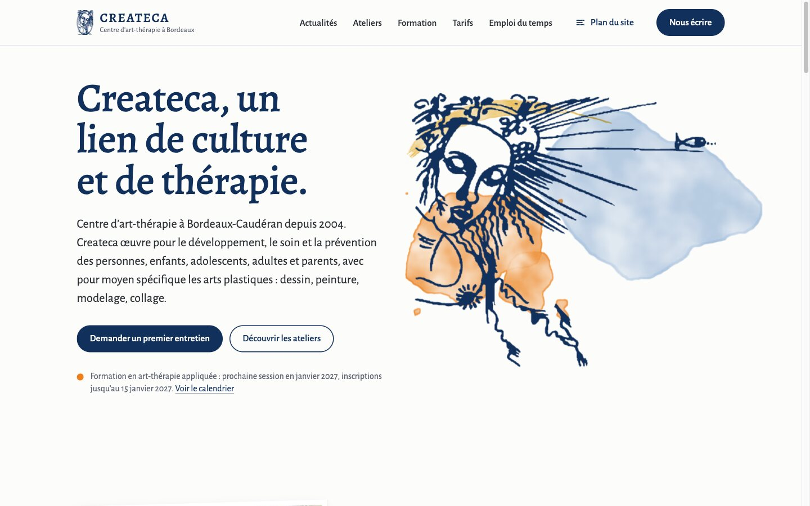
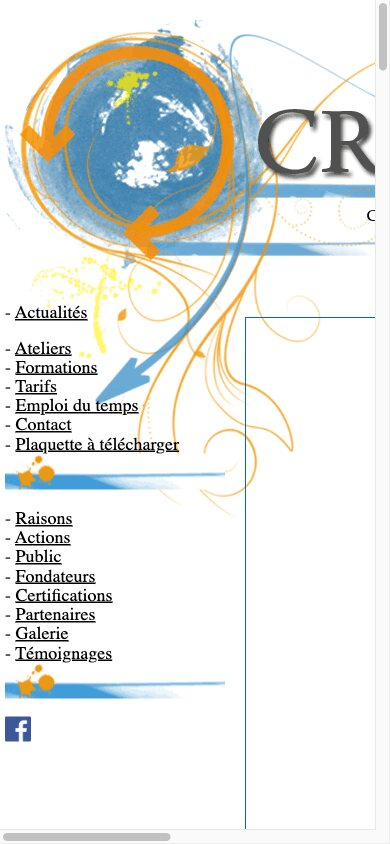
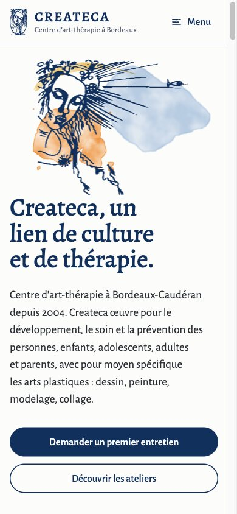

Createca a un nouveau site, à l’adresse [createca.vercel.app](https://createca.vercel.app/). Il reprend les textes et les images de l’ancien site, createca.free.fr, et les présente autrement : lisibles sur tous les écrans, accessibles et rangés pour trouver vite l’essentiel.

## Avant, après

Les deux captures ont été prises le 21 octobre 2026, à la même taille d’écran.

**Avant**, sur ordinateur : createca.free.fr

**Après**, sur ordinateur : createca.vercel.app

**Avant**, sur téléphone

**Après**, sur téléphone

## Ce qui change

- **Lisible sur téléphone.** L’ancien site n’avait pas de réglage pour les mobiles et tenait dans un tableau de 555 pixels de large. Le nouveau s’adapte à la largeur de chaque écran.
- **Connexion sécurisée.** L’ancienne adresse s’affiche « Non sécurisé » dans le navigateur. Le nouveau site est servi en HTTPS.
- **Accessible.** Contrastes, titres, liens et formulaire sont pensés pour les lecteurs d’écran et la navigation au clavier. L’outil Lighthouse de Google donne 100 sur 100 en accessibilité aux pages mesurées le 21 octobre 2026.
- **Rapide.** Sur mobile, le même outil donne 99 sur 100 en performance à la page d’accueil.
- **Une page par actualité.** Chaque annonce a sa propre page, classée par type : formation, portes ouvertes, expositions, certifications.
- **L’essentiel à portée de main.** Les ateliers, la formation, les tarifs et l’emploi du temps sont en tête du menu, sur toutes les pages. La certification Qualiopi ouvre la page de la formation.
- **Un formulaire de contact.** Les messages arrivent à [createca@free.fr](mailto:createca@free.fr).

## Une réalisation de Waimia

Le site a été conçu et réalisé par [Waimia](https://waimia.com).
